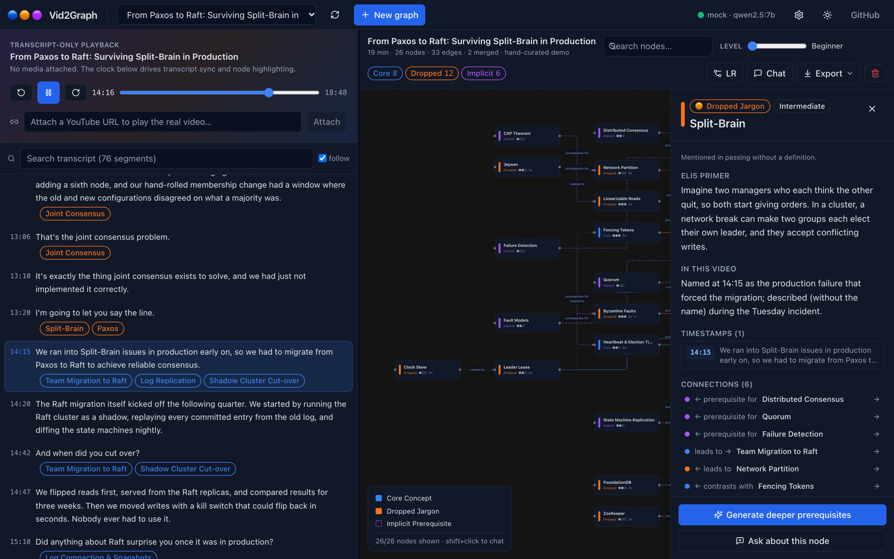
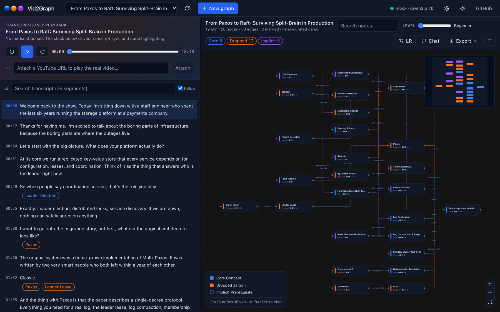
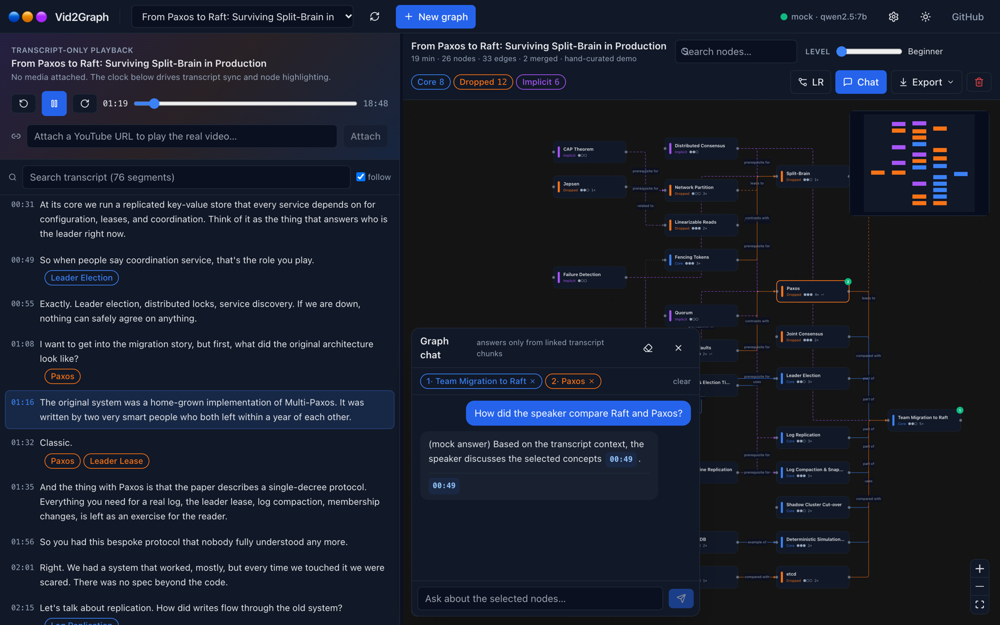
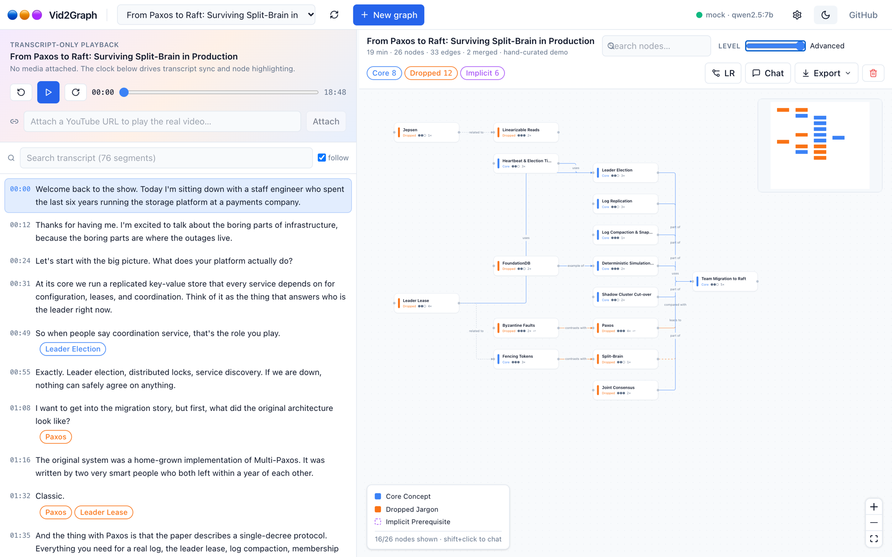
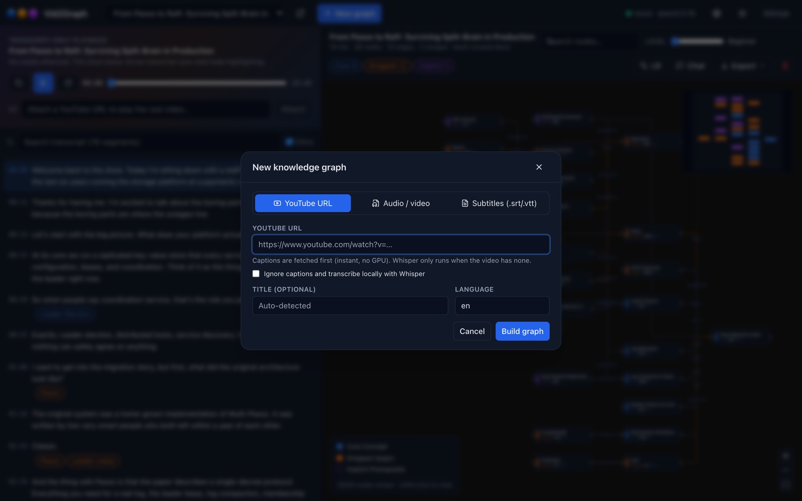
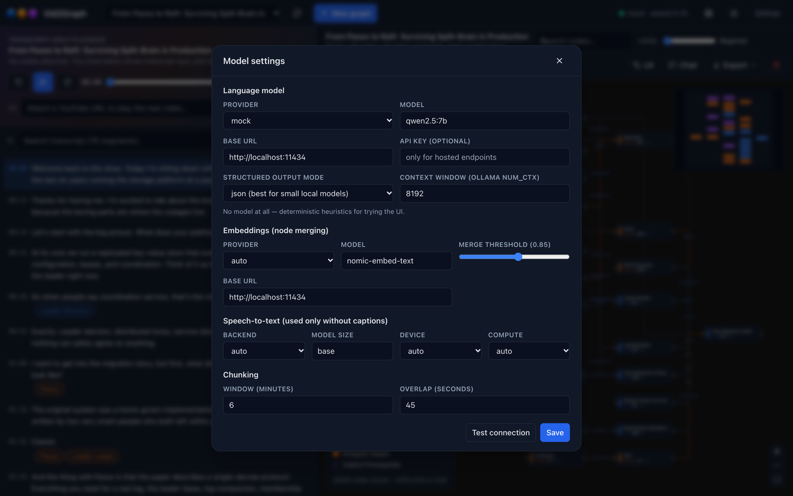

<div align="center">


# Vid2Graph

### Turn any YouTube video, podcast, or lecture into an interactive knowledge graph. 100% local. No API key required.

**Video → transcript → concepts → clickable graph.** Vid2Graph finds the ideas a speaker *explains* 🔵, the jargon they *drop without defining* 🟠, and the prerequisites they *assume you already know* 🟣, then links every node back to the exact second it was said.

[](https://github.com/your-username/vid2graph/actions)
[](LICENSE)
[](backend/)
[](frontend/)
[](#%EF%B8%8F-configuration)
[](CONTRIBUTING.md)
[](https://github.com/your-username/vid2graph/stargazers)

[**Quickstart**](#-quickstart) · [Screenshots](#-see-it-in-action) · [Features](#-features) · [Examples](#-examples) · [How it works](#-how-it-works) · [Configuration](#%EF%B8%8F-configuration) · [API](#-api) · [Contributing](#-contributing--feedback)



<sub>Click the orange <b>Split-Brain</b> node → the player jumps to 14:15, the transcript scrolls to the line, and the inspector shows an ELI5 primer, every timestamp, and the prerequisite chain.</sub>

</div>

---

> **If Vid2Graph saves you an hour of pausing and Googling, please ⭐ star the repo.** It is the single best way to help other learners find it.

## 🤔 Why does this exist?

Video and audio are **linear**. A 90-minute engineering podcast scatters concepts everywhere, and experts name-drop terms like *Split-Brain*, *Paxos*, *Backpressure*, or *KV-Cache* without ever defining them. You pause every three minutes to search, lose the thread, and quit at minute 23.

Summarizers give you a wall of bullet points. Vid2Graph gives you a **map**:

| Layer | What it captures | Why it matters |
|---|---|---|
| 🔵 **Core Concepts** | Topics the speaker explicitly explains or analyses | The actual content of the talk |
| 🟠 **Dropped Jargon** | Terms mentioned in passing *without* explanation | The words that made you pause |
| 🟣 **Implicit Prerequisites** | Foundations **never named** in the video, inferred as required to follow it | The gap between you and the speaker |

Everything runs on your machine with a 7B model through [Ollama](https://ollama.com), LM Studio, vLLM, or any OpenAI-compatible endpoint. Your lectures, meetings, and podcasts never leave your disk unless you choose a cloud model.

## 📸 See it in action

| Three-layer graph with synced transcript | Graph-RAG chat on selected nodes |
|---|---|
|  |  |
| Purple prerequisites flow into orange jargon into blue core topics. Nodes pulse as the speaker reaches them. | Shift-click 1 to 3 nodes and ask. Answers are grounded only in the linked transcript chunks and cite `[mm:ss]`. |

| Knowledge-level slider (light theme, "Advanced") | Ingest anything |
|---|---|
|  |  |
| *Beginner* shows the full scaffolding; *Advanced* keeps only the novel material. | YouTube link, local audio/video, or an `.srt`/`.vtt` file. Captions are fetched first, Whisper only runs when needed. |

<details>
<summary><b>Model settings modal</b> (swap providers at runtime, no restart)</summary>



</details>

> The screenshots show the pre-seeded demo graph with the built-in `mock` provider, so you can reproduce them with nothing installed. With a real model the graph is extracted from your own video.

## ✨ Features

- **🎬 Synchronized workspace.** Player (YouTube embed, local file, or a transcript-only clock), searchable auto-scrolling transcript, and the graph side by side. Click a timestamp anywhere and everything follows.
- **🧠 Three-layer concept extraction.** Core concepts, dropped jargon, and *implicit* prerequisites the speaker never said out loud.
- **🔗 Every node links to the exact second.** Multiple mentions become multiple timestamp pills: *"LLM" at 10:15* and *"Large Language Model" at 45:30* merge into one node.
- **🎚 Knowledge-level slider.** Beginner / Intermediate / Advanced hides what you already know and keeps the graph readable.
- **🔍 Inspector drawer.** ELI5 primer, what was said in *this* video, all mentions, connections, aliases, and **Generate deeper prerequisites** to expand a node's tree on demand.
- **💬 Graph-RAG chat.** Ask questions about 1 to 3 selected nodes. Answers come only from the transcript chunks linked to those nodes, with clickable `[mm:ss]` citations.
- **📝 Obsidian & Notion export.** One Markdown file with `[[wiki-links]]`, or a `.zip` vault of atomic notes with YAML frontmatter and `?t=855` deep links.
- **🔌 Model-agnostic.** Ollama, LM Studio, vLLM, OpenAI, or any OpenAI-compatible server. Switch and test from the settings modal.
- **🎙 Transcription that picks the cheapest path.** YouTube captions via `yt-dlp` (instant, no GPU), then `faster-whisper`, `mlx-whisper` (Apple Silicon), or `whisper.cpp`.
- **🔒 Local-first and private.** One SQLite file, media on disk, zero telemetry.
- **🧪 Tested without a model.** A deterministic `mock` provider runs the whole pipeline in CI and lets you try the UI in 30 seconds.

## 🚀 Quickstart

### Option A: Docker (one command)

```bash
git clone https://github.com/your-username/vid2graph.git && cd vid2graph
```
```bash
cp .env.example .env
```
```bash
docker compose up --build
```

Open <http://localhost:3000>. The backend talks to **Ollama on your host** through `host.docker.internal:11434`. To run Ollama inside Compose as well:

```bash
docker compose --profile ollama up --build
```

### Option B: Local dev with hot reload

Requirements: Python 3.10+ (3.12 recommended), Node 18+, and [Ollama](https://ollama.com) or any OpenAI-compatible server.

```bash
ollama pull qwen2.5:7b && ollama pull nomic-embed-text
```
```bash
make setup
```
```bash
make backend
```
```bash
make frontend
```

Backend on <http://localhost:8000> (API docs at `/docs`), frontend on <http://localhost:3000>. Port busy? `PORT=8002 make backend` and set `NEXT_PUBLIC_API_URL=http://localhost:8002` in `frontend/.env.local`.

<details>
<summary>No <code>make</code>? Equivalent commands</summary>

```bash
cd backend && python -m venv .venv && .venv/bin/pip install -r requirements.txt && .venv/bin/uvicorn app.main:app --reload
```
```bash
cd frontend && npm install && npm run dev
```

</details>

### Option C: Try it with nothing installed

Set `VID2GRAPH_LLM_PROVIDER=mock` in `.env` (or pick **mock** in the settings modal). The full pipeline runs on deterministic heuristics, the demo graph is pre-seeded, and you can explore every feature of the UI before downloading a single model.

### No GPU?

- **YouTube captions** are pulled first. Most lectures and podcasts have them, so Whisper never runs.
- **Subtitle uploads** (`.srt` / `.vtt`) are parsed directly.
- **Whisper on CPU** works with the `base` or `small` model. Apple Silicon users get GPU speed with `pip install mlx-whisper`.
- **Embeddings degrade gracefully:** Ollama → sentence-transformers → a dependency-free hashed-trigram vectoriser.

## 💡 Examples

### Build a graph from a YouTube video with `curl`

```bash
curl -s -X POST http://localhost:8000/api/ingest -F url="https://www.youtube.com/watch?v=VIDEO_ID"
```
```json
{"job_id": "a1b2c3", "graph_id": "f4e5d6", "status": "queued"}
```

Poll the job, then fetch the finished graph:

```bash
curl -s http://localhost:8000/api/jobs/a1b2c3
```
```bash
curl -s http://localhost:8000/api/graphs/f4e5d6 | jq '.nodes[] | {label, layer, difficulty, first_mention: .mentions[0].start}'
```

### Upload a local recording or a subtitle file

```bash
curl -s -X POST http://localhost:8000/api/ingest -F file=@lecture.mp4 -F title="Distributed Systems, Lecture 7"
```
```bash
curl -s -X POST http://localhost:8000/api/ingest -F file=@podcast.srt
```

### Ask the graph a question (Graph-RAG)

```bash
curl -s -X POST http://localhost:8000/api/graphs/demo-distributed-systems/chat \
  -H 'content-type: application/json' \
  -d '{"node_ids": ["jargon_paxos", "core_raft_migration"], "question": "How did the speaker compare Raft and Paxos?"}'
```

The answer cites timestamps such as `[07:02]`, and the UI renders each one as a pill that seeks the player.

### What the Obsidian export looks like

```markdown
# From Paxos to Raft: Surviving Split-Brain in Production

## Map of Content
### 🔵 Core Concepts
- [[Leader Election]] · intermediate
- [[Log Replication]] · intermediate
### 🟠 Dropped Jargon
- [[Paxos]] · advanced
- [[Split-Brain]] · intermediate
### 🟣 Implicit Prerequisites
- [[Distributed Consensus]] · intermediate
- [[Quorum]] · beginner

---

## Split-Brain
**Layer:** 🟠 Dropped Jargon · **Difficulty:** intermediate

### ELI5
Imagine two managers who each think the other quit, so both start giving orders...

### Mentions
- [14:15](https://www.youtube.com/watch?v=VIDEO_ID&t=855s) — _We ran into Split-Brain issues in production early on..._

### Connections
- requires [[Distributed Consensus]], [[Quorum]]
- leads to [[Team Migration to Raft]]
```

Drop the `.md` into any Obsidian vault and the `[[wiki-links]]` resolve immediately. The vault `.zip` gives you one note per concept with YAML frontmatter for Dataview.

### The reference scenario

At `14:15` of the bundled demo, an engineer says *"We ran into Split-Brain issues in production early on, so we had to migrate from Paxos to Raft to achieve reliable consensus."* Vid2Graph produces:

```
🟣 Distributed Consensus ─┐
🟣 Quorum ────────────────┼─ prerequisite for ─▶ 🟠 Split-Brain ─ leads to ─▶ 🔵 Team Migration to Raft
🟣 Failure Detection ─────┘                                                        ▲
🟠 Paxos ───────────────────────────────────── compared with ──────────────────────┘
```

## 🧠 How it works

Small local models (7B to 14B) collapse when handed a 20,000-word transcript. The pipeline is built so they never see one:

```
 YouTube URL ──▶ yt-dlp captions ─┐
 .srt / .vtt ───▶ parser ─────────┼──▶ transcript (exact start/end per utterance)
 audio / video ─▶ faster-whisper ─┘            │
                                               ▼
            Stage 2   timestamp-anchored chunks  (5–8 min windows, 45 s overlap, [mm:ss] markers)
                                               │
            Stage 3a  per chunk, in parallel    ▼   LiteLLM + Instructor, JSON mode
                  ChunkExtraction { concepts: [{name, layer: core|jargon, timestamp, snippet}] }
                                               │
            Stage 4   entity resolution         ▼   normalise → aliases/acronyms → embeddings cosine ≥ 0.85
                                               │
            Stage 3b  on the concept LIST only  ▼   tiny token footprint
                  EnrichmentBatch { difficulty, eli5, summary }        (batches of 20)
                  SynthesisBatch  { prerequisites[], relations[] }      (batches of 40)
                                               │
                  final resolution → SQLite → React Flow
```

1. **Transcript source.** The cheapest available path wins: captions, then a subtitle file, then Whisper.
2. **Chunking keeps real seconds.** Every line starts with `[mm:ss]`, so the model *quotes* timestamps instead of inventing them.
3. **Two-pass extraction.** The heavy text pass only asks for a flat list. The reasoning pass (prerequisites, difficulty, edges, ELI5) sees only concept names, so a 7B model handles a two-hour lecture.
4. **Entity resolution.** A union-find merges synonyms using lexical rules, acronym and alias matching, then embedding similarity. Explicitly mentioned concepts always beat inferred prerequisites of the same name.
5. **Validated output.** Every structured call goes through Pydantic via Instructor with retries and a lenient JSON-extraction fallback. A chatty model degrades one chunk, never the run.

## ⚙️ Configuration

Copy `.env.example` to `.env`. All keys are prefixed `VID2GRAPH_` and can also be changed at runtime in the settings modal (persisted in SQLite).

| Key | Default | Notes |
|---|---|---|
| `LLM_PROVIDER` | `ollama` | `ollama` · `lmstudio` · `vllm` · `openai` · `openai_compatible` · `mock` |
| `LLM_MODEL` | `qwen2.5:7b` | Model name as the provider knows it |
| `LLM_BASE_URL` | `http://localhost:11434` | LM Studio `http://localhost:1234/v1`, vLLM `http://localhost:8000/v1` |
| `LLM_API_KEY` | *(empty)* | Only for hosted endpoints |
| `LLM_STRUCTURED_MODE` | `json` | Instructor mode: `json` (safest locally) · `tools` · `md_json` |
| `EMBEDDING_PROVIDER` | `auto` | `auto` → ollama → sentence-transformers → hash |
| `EMBEDDING_MODEL` | `nomic-embed-text` | |
| `MERGE_THRESHOLD` | `0.85` | Cosine similarity above which nodes merge |
| `WHISPER_BACKEND` | `auto` | `faster-whisper` · `mlx` (Apple Silicon) · `whisper.cpp` · `none` |
| `WHISPER_MODEL` | `base` | `tiny` … `large-v3`, `distil-large-v3` |
| `WHISPER_DEVICE` / `WHISPER_COMPUTE_TYPE` | `auto` | CUDA → `float16`, CPU → `int8` |
| `CHUNK_MINUTES` / `CHUNK_OVERLAP_SECONDS` | `6` / `45` | |
| `DATA_DIR` | `./data` | SQLite DB and uploaded media |
| `SEED_DEMO` | `true` | Seed the Raft/Paxos demo on first boot |
| `DEMO_MEDIA_URL` | *(empty)* | Optional YouTube URL to attach to the demo's player |

**Recommended local models:** `qwen2.5:7b` (excellent JSON adherence), `qwen2.5:14b`, `llama3.1:8b`, `gemma2:9b`.
**Transcription:** `faster-whisper` with `base`/`small` on CPU, `large-v3` on CUDA, `mlx-whisper` on Apple Silicon.

## 🏗 Architecture

```
vid2graph/
├── backend/                      FastAPI · Python 3.12
│   ├── app/
│   │   ├── main.py               app factory, CORS, lifespan: load settings + seed demo
│   │   ├── api/routes.py         /api/ingest, /jobs, /graphs CRUD, expand, chat, export, media, settings, health
│   │   ├── core/
│   │   │   ├── config.py         pydantic-settings, VID2GRAPH_* env
│   │   │   ├── runtime_settings.py  UI-editable overrides persisted in SQLite
│   │   │   ├── llm.py            LiteLLM + Instructor client, lenient JSON fallback, provider probes
│   │   │   └── mock_llm.py       deterministic provider for tests / no-model demo
│   │   ├── pipeline/
│   │   │   ├── extractor.py      SRT/VTT parser (YouTube rolling-caption dedupe), yt-dlp, Whisper backends
│   │   │   ├── chunker.py        time-window chunking with overlap + [mm:ss] markers
│   │   │   ├── graph_gen.py      two-pass structured extraction, expansion, titles
│   │   │   ├── resolver.py       entity resolution (union-find: lexical + embeddings), graph merging
│   │   │   ├── embeddings.py     Ollama → sentence-transformers → hash fallback chain
│   │   │   ├── chat.py           Graph-RAG over node-linked chunks with citations
│   │   │   ├── exporter.py       Markdown / Obsidian vault zip
│   │   │   └── jobs.py           background job runner with persisted progress
│   │   ├── db/database.py        SQLite (WAL), JSON document columns
│   │   ├── db/seed_demo.py       the distributed-systems demo graph
│   │   └── models/schemas.py     Pydantic models shared by pipeline, DB and API
│   └── tests/                    pytest suite (runs with the mock provider, no model needed)
├── frontend/                     Next.js 14 · TypeScript · Tailwind · React Flow · Zustand
│   └── src/
│       ├── components/
│       │   ├── Workspace.tsx     split-screen layout, job polling, ?graph=&t= deep links
│       │   ├── VideoPlayer.tsx   YouTube iframe API · HTML5 media · transcript-only clock
│       │   ├── TranscriptPanel.tsx  searchable, auto-scrolling, concept chips per segment
│       │   ├── GraphCanvas.tsx   React Flow + dagre, playhead highlighting, shift-click selection
│       │   ├── NodeDrawer.tsx    inspector: ELI5, timestamps, connections, expand
│       │   ├── GraphChat.tsx     multi-node Graph-RAG chat with citation pills
│       │   ├── IngestModal.tsx   YouTube / media / subtitle upload
│       │   └── SettingsModal.tsx provider presets + connection test
│       └── lib/                  api.ts (typed client), store.ts (Zustand + level filter), layout.ts (dagre)
├── docs/screenshots/
├── docker-compose.yml            backend + frontend (+ optional ollama profile)
├── .env.example
└── Makefile
```

## 🔌 API

Interactive docs at <http://localhost:8000/docs>.

| Method | Path | Purpose |
|---|---|---|
| `POST` | `/api/ingest` | multipart: `url` *or* `file`, `title`, `language`, `force_whisper` → `{job_id, graph_id}` |
| `GET` | `/api/jobs/{id}` | stage, progress 0–1, message, log |
| `GET` | `/api/graphs` · `/api/graphs/{id}` | list (metadata) / full graph with transcript, chunks, nodes, edges |
| `PATCH` · `DELETE` | `/api/graphs/{id}` | rename, attach a YouTube `media_url`, delete |
| `POST` | `/api/graphs/{id}/nodes/{node_id}/expand` | generate deeper prerequisites, merged into the graph |
| `POST` | `/api/graphs/{id}/chat` | `{node_ids[1-3], question, history}` → answer + citations |
| `GET` | `/api/graphs/{id}/export?format=markdown\|vault` | `.md` or `.zip` |
| `GET` | `/api/media/{id}` | uploaded media for the player |
| `GET` · `PUT` · `POST` | `/api/settings` · `/api/settings/test` | runtime model settings + connectivity probe |
| `GET` | `/api/health` | provider reachability, Whisper backend, graph count |

## 🧪 Tests

```bash
make test
```
```bash
cd frontend && npm run lint && npm run build
```

The backend suite runs with the `mock` provider, so CI needs no model, GPU, or network.

## 🎯 Who is it for?

- **Students** turning a 2-hour lecture into a prerequisite tree they can study bottom-up.
- **Engineers** onboarding from conference talks and podcasts without pausing to search every acronym.
- **Researchers** mapping a seminar series into one Obsidian vault with timestamped sources.
- **Self-learners** who want to know *what they don't know yet* before pressing play.

## 🗺 Roadmap

- [ ] Streaming job logs and chat tokens over SSE
- [ ] Speaker diarisation (pyannote / whisperX)
- [ ] Multi-video graphs: merge a whole course into one map
- [ ] Spaced-repetition flashcards (Anki export) from nodes
- [ ] Logseq and Notion-native export
- [ ] Browser extension: a "Graph this video" button on YouTube

Want one of these sooner? Open an issue and say so, or upvote an existing one.

## 🤝 Contributing & feedback

**All contributions and feedback are welcome**, from a typo fix to a new Whisper backend. This project is intentionally small and readable, and it should stay that way.

- 🐛 **Found a bug?** [Open a bug report](https://github.com/your-username/vid2graph/issues/new?template=bug_report.md) with the video type, model, and the job log.
- 💡 **Have an idea?** [Request a feature](https://github.com/your-username/vid2graph/issues/new?template=feature_request.md). Prompt-tuning results for specific model families are especially valuable.
- 🛠 **Want to hack on it?** Read [CONTRIBUTING.md](CONTRIBUTING.md) for the dev setup and where things live. Good first issues: new export targets, more Whisper backends, UI polish.
- 💬 **Just want to say what worked or didn't?** Open a discussion or an issue. Honest feedback on real videos shapes the roadmap.

If you build something with Vid2Graph, share a screenshot in an issue. It will be featured here.

## ⭐ Support the project

If this project helped you learn something, **star the repository** and share it with someone who learns from videos. Stars help other people discover it.

## 📄 License

[MIT](LICENSE). Use it, fork it, ship it.

---

<sub>Keywords: video to knowledge graph · YouTube to mind map · podcast knowledge graph · lecture notes generator · local LLM · Ollama · Whisper transcription · Graph RAG · Obsidian export · concept map from video · prerequisite tree · jargon explainer · self-hosted · privacy-first · FastAPI · Next.js · React Flow</sub>
